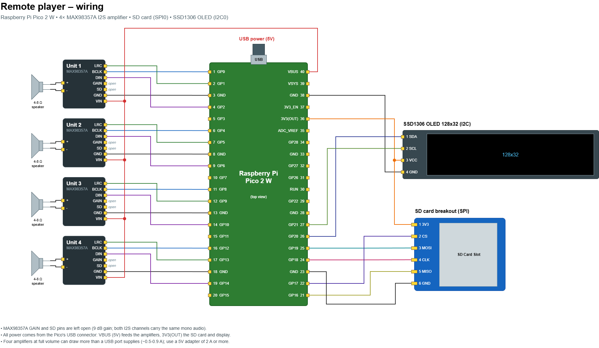

# Remote player

Firmware for a Raspberry Pi Pico 2 W that plays WAV and MP3 files from an SD card on up to four
MAX98357A I2S amplifiers, each with its own speaker. You control it with MQTT messages or from
its built-in web page. A small OLED display (optional) shows the status.

## Hardware

| Part                                               | Quantity        |
|----------------------------------------------------|-----------------|
| Raspberry Pi Pico 2 W                              | 1               |
| MAX98357A I2S amplifier breakout (Adafruit layout) | 1-4             |
| Speaker, 4-8 Ω, max 3 W                            | 1 per amplifier |
| SD card breakout (SPI)                             | 1               |
| SSD1306 OLED, 128x32, I2C (optional)               | 1               |

### Wiring



The diagram is a PNG with an embedded [draw.io](https://www.drawio.com/) diagram. In VS Code,
open it with the Draw.io Integration extension (`hediet.vscode-drawio`) to edit it in place.
The pin assignments are defined in [src/pins.h](src/pins.h); when you change them, update the
tables below and this diagram too.

**Amplifier units.** Each unit's pins are grouped around a GND pin on the left side of the Pico:

| Unit | BCLK          | LRC           | GND    | DIN           |
|------|---------------|---------------|--------|---------------|
| 1    | GP0 (pin 1)   | GP1 (pin 2)   | pin 3  | GP2 (pin 4)   |
| 2    | GP4 (pin 6)   | GP5 (pin 7)   | pin 8  | GP6 (pin 9)   |
| 3    | GP8 (pin 11)  | GP9 (pin 12)  | pin 13 | GP10 (pin 14) |
| 4    | GP12 (pin 16) | GP13 (pin 17) | pin 18 | GP14 (pin 19) |

- VIN of every amplifier goes to 5 V (VBUS, pin 40, or an external supply).
- Leave GAIN open for 9 dB, or see the MAX98357A datasheet for other gains.
- Leave SD open. Both I2S channels carry the same mono audio, so any channel selection works.
- LRC must be the GPIO right after BCLK, because the I2S outputs run on the PIO blocks.
- Only the number of units set on the settings page is used, starting with unit 1.

**SD card reader (SPI0):**

| SD module | Pico              |
|-----------|-------------------|
| MISO (DO) | GP16 (pin 21)     |
| CS        | GP17 (pin 22)     |
| SCK (CLK) | GP18 (pin 24)     |
| MOSI (DI) | GP19 (pin 25)     |
| GND       | GND (pin 23)      |
| VCC       | 3V3(OUT) (pin 36) |

**Display (I2C0, address 0x3C):**

| Display | Pico              |
|---------|-------------------|
| SDA     | GP20 (pin 26)     |
| SCL     | GP21 (pin 27)     |
| GND     | GND (pin 38)      |
| VCC     | 3V3(OUT) (pin 36) |


### Power

- VBUS only carries 5 V while the Pico is powered over USB. Four amplifiers at full volume can
  draw more than a USB port supplies, so use a 5 V adapter of 2 A or more, or power the
  amplifiers from a separate 5 V supply with its GND connected to the Pico's GND.
- SD card readers without a regulator need 3.3 V. Modules with a regulator and level shifter
  (marked 5 V) can take VBUS instead; their outputs are still 3.3 V.

## Building and flashing

1. Install [PlatformIO](https://platformio.org/) (the VS Code extension or the CLI).
2. Open this folder and build: `pio run`. The dependencies in
   [platformio.ini](platformio.ini) are downloaded on the first build.
3. The first upload must go over USB: hold BOOTSEL while plugging in the Pico if needed, then
   run `pio run -t upload`.
4. After that you can upload over WiFi. Set an OTA password on the settings page first: without
   one, OTA updates are disabled. Then uncomment the `upload_protocol`, `upload_port` and
   `upload_flags` lines in `platformio.ini`, and fill in your hostname and OTA password.

The serial monitor (`pio device monitor`, 115200 baud) shows the start-up log and every
command.

The build runs [helix_in_ram.py](helix_in_ram.py), which places the MP3 decoder in RAM instead
of flash. Without it, decoding MP3 on several units at once is too slow (see the script for
details).

## First-time setup

1. Power the device. Without WiFi settings, it starts an access point named `remote-player`.
2. Connect to that access point. A captive portal opens the settings page; if it doesn't,
   browse to `http://192.168.4.1/`.
3. Fill in the WiFi network, hostname, the number of amplifier units, and optionally an OTA
   password, a web password and an MQTT broker (`host` or `host:port`, with an optional user,
   password and topic), then save. The device restarts and connects.
4. From then on, the web page is available at `http://<hostname>.local/`.

If the configured WiFi can't be reached at start-up, the device falls back to the access
point. It then restarts every 5 minutes to try again, unless someone is connected to the
access point.

Defaults: hostname `remote-player`, no OTA password, no web password, no MQTT broker (MQTT topic
`remote-player`), one unit.

### Passwords

- **OTA password**: needed for firmware uploads over WiFi. Without one, OTA updates are disabled;
  the device stays reachable as `<hostname>.local`.
- **Web password**: protects the web interface and the HTTP command endpoint with the user
  `admin` (HTTP basic authentication). Without one, no login is needed. The password is sent
  unencrypted over HTTP, so it only keeps out casual access on a trusted network.
- In access point mode with a web password set, the web interface only offers the WiFi settings,
  without login, so the device can always be connected to a new network. Everything else needs
  the device to be connected first.

In the settings, an empty password field keeps the current password; tick the checkbox below it
to remove it.

## SD card

Format the card as FAT16, FAT32 or exFAT and put the audio files in the root folder. WAV and
MP3 files of any sample rate and channel count work; everything is played as 44.1 kHz mono.

| Track in a command | File played                                           |
|--------------------|-------------------------------------------------------|
| `14`               | `/0014.wav`, or `/0014.mp3` if there is no WAV file   |
| `"hello"`          | `/hello.wav`, or `/hello.mp3` if there is no WAV file |

You can also upload, rename and delete files on the **Files** page of the web interface.

## Commands

Send commands as MQTT messages to the configured topic (when MQTT is configured), as HTTP
requests, or type them on the **Status** page. The **Usage** page on the device has the full
reference. In short:

```
[unit:]command [arguments]
```

The unit prefix is `1`-`4` or `all`; without a prefix the command goes to unit 1.

| Command                  | What it does                                                      |
|--------------------------|-------------------------------------------------------------------|
| `play TRACKS`            | Plays a track once                                                |
| `loop TRACKS`            | Plays a track over and over until stopped                         |
| `repeat TRACKS [COUNT]`  | Plays COUNT tracks in a row; without COUNT, until stopped         |
| `replace TRACKS [TRANS]` | Changes the tracks a running repeat picks from; TRANS plays first |
| `delayed TRACKS MS`      | Plays a track after MS milliseconds (max 5000)                    |
| `stop`                   | Stops playback                                                    |
| `volume N`               | Sets the volume, 0-30 (saved)                                     |
| `disable` / `enable`     | Blocks or allows playback (saved)                                 |

`TRACKS` is one track (`4`, `"hello"`) or a list to pick from at random (`1,"hello",6`).

Examples: `play 4`, `2:loop "chime"`, `3:repeat 1,2,3 5`, `all:volume 20`, `all:stop`.

Over HTTP, POST the command as the form field `cmd` to `/command`; the response is the command's
log output as plain text. Add `-u admin:PASSWORD` when a web password is set:

```
curl --data-urlencode "cmd=2:play 4" http://remote-player.local/command
curl -u admin:PASSWORD --data-urlencode "cmd=2:play 4" http://remote-player.local/command
```

## Code structure

```
src/
  main.cpp            start-up, WiFi, and which work runs on which core
  pins.h              every GPIO used
  parsing.h           number and command-line parsing helpers
  audio/
    audio.*           decoding and I2S output per unit
    track.*           track numbers/names and their file names
  players/
    players.*         command parsing and per-unit state (repeat, delayed, volume, ...)
  storage/
    sd_card.*         shared SD card access (lock, mount, file name rules)
    config.*          device settings
    settings_store.*  key/value storage on LittleFS
  network/
    web.*             web pages, file manager, OTA, captive portal
    web_templates.h   HTML of the web pages
    html_writer.*     streams HTML pages in chunks
    mqtt_handler.*    MQTT connection
  display/
    display.*         OLED status screen
```

Core 0 runs WiFi, the web server, MQTT, command handling and the display. Core 1 runs only the
audio, so network activity can't cause dropouts. The SD card is shared through the lock in
[src/storage/sd_card.h](src/storage/sd_card.h).
